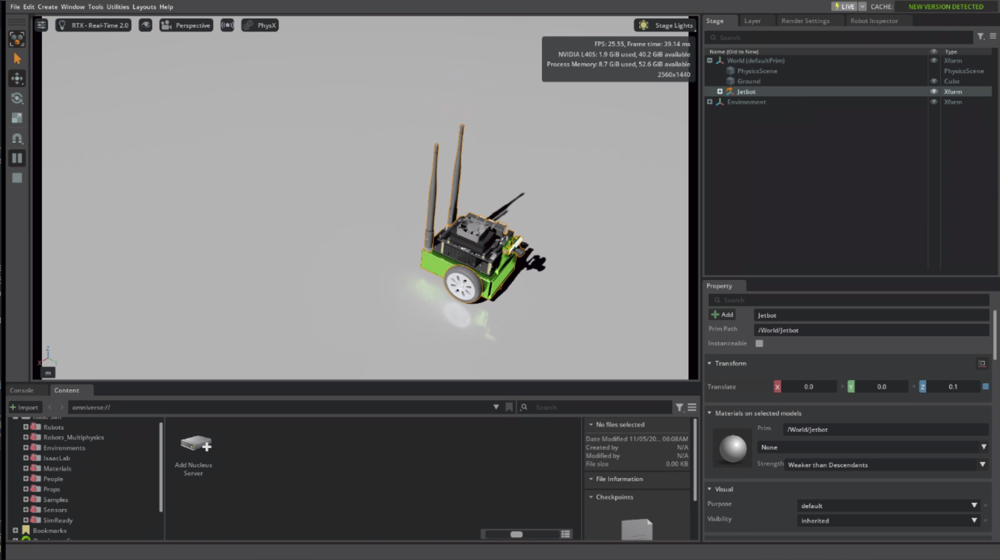

# hello-nvidia

This repo holds my preparation for NVIDIA's Senior Content Engineer, KnowledgeOps role. I asked one question: **how does a newcomer get from nothing to a working Isaac Sim simulation, using only NVIDIA's published agent skills?**

I answered that question in two parts:

1. **I measured the skills as a content set before using them.** Working with an AI agent (Gemini), I produced short Python scripts that check how the `SKILLS.md` router covers the 44 skills, count every H2 heading, measure the descriptions, and lint the set against agent-facing practices. The agent wrote the code. I decided what to measure, ran the scripts, and checked the results.
2. **I used the skills the way a newcomer would.** My done test was Isaac Sim running on a Brev cloud GPU, streaming to my laptop's browser, with a robot visibly driving. I logged every point of friction along the way.

## What's here

| Folder | What you'll find |
| --- | --- |
| [brev-first-simulation/](brev-first-simulation/) | The full write-up: every step with why, the command and what happened, the three gaps I found, recommendations, and a 43-entry friction log |
| [skills-audit/](skills-audit/) | The audit scripts, their output against the `release/6.3` skills, and what the numbers say |
| [hello-isaac-sim/](hello-isaac-sim/) | A one-page spec for a beginner skill, with done criteria and tests |
| [human-docs-notes/](human-docs-notes/) | What I noticed in the human-facing docs before I touched the skills |
| [cheatsheets/](cheatsheets/) | Commands, ports and addresses on one page each |
| [tools/](tools/) | The checks that CI runs on this repo |

## The short version

The skills work well for the setup they were built for: a browser on the same machine or the same local network as Isaac Sim. My setup was different, a laptop browser and a cloud GPU, and three gaps got in the way:

- **The browser couldn't connect.** The web viewer skill uses one network address for two jobs: the address the server listens on, and the address the browser opens. On a cloud machine those have to be different addresses.
- **Three firewall ports had to be opened.** NVIDIA's Brev documentation says so, but the skill doesn't.
- **The skills stop once Isaac Sim is on screen.** Driving a robot took a second skill and a restart.

A small override file fixed the address problem. After that, an agent added a Jetbot and drove the robot, and I confirmed the move twice: from the position data, and with my own eyes in the browser.

## What's left to do

The full list, with the reason for each item, is in [TODO.md](TODO.md). In short: the scripts need tests, `hello-isaac-sim` needs building and evals, two Brev findings need reproducing, and no repeat run has been timed.

## How this repo is checked

Every push runs [tools/check_repo.py](tools/check_repo.py) in GitHub Actions. The check fails if a relative link is broken, if a Python script doesn't compile, or if a real IP address slips into the docs. Addresses in the docs are placeholders such as `<PUBLIC_IP>`.
