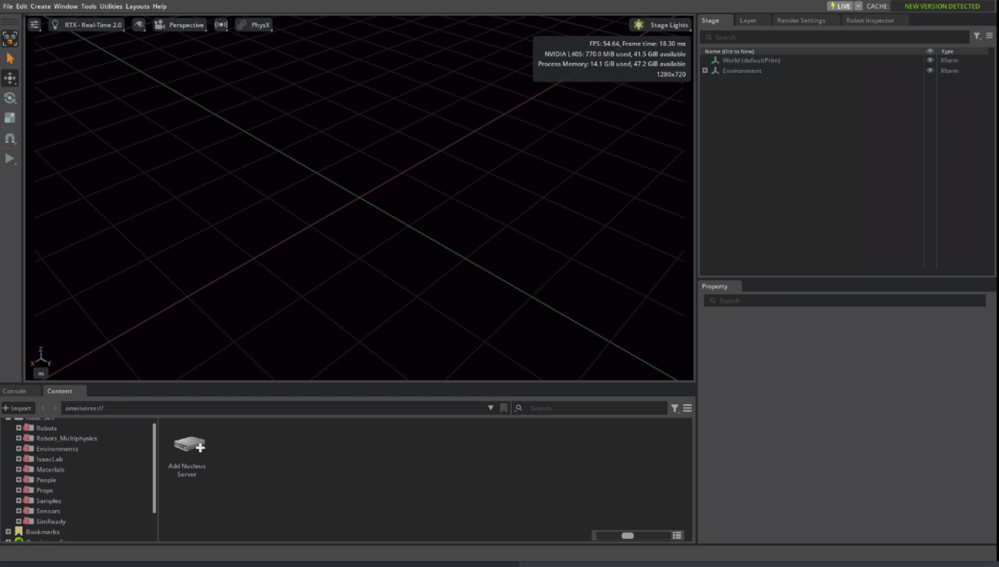
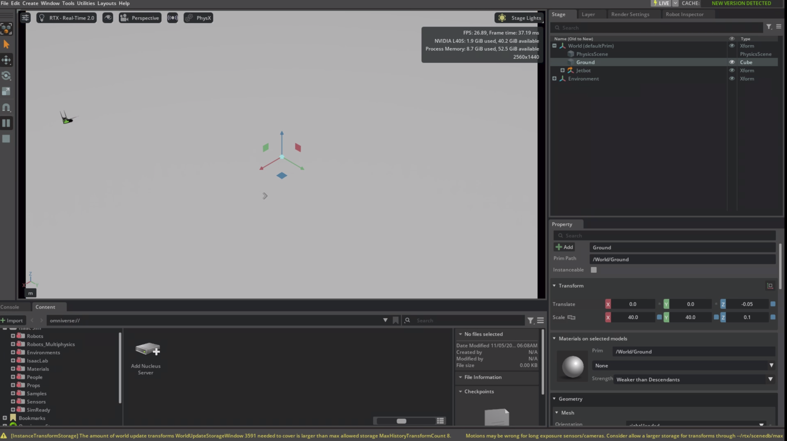
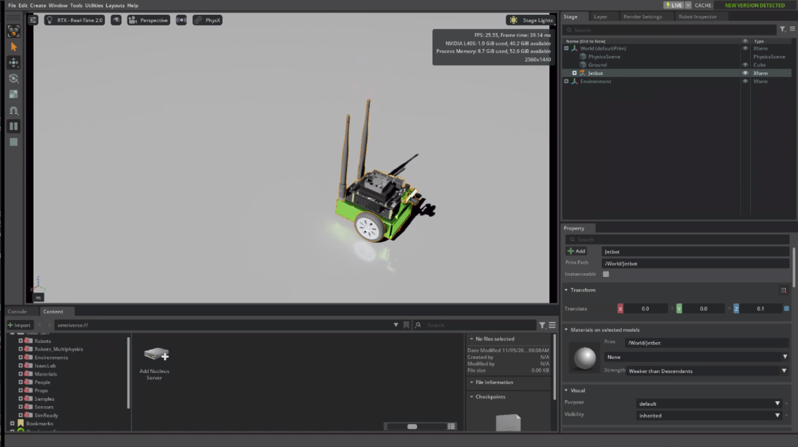

# Isaac Sim on Brev: first simulation and recommendations

## Summary

I wanted to find out how a newcomer gets started with Isaac Sim using only NVIDIA's published agent skills. So I rented a cloud GPU on Brev, NVIDIA's GPU rental service, and asked an AI agent to set up Isaac Sim and show it in my laptop's browser.

In the end it worked. Isaac Sim ran on the cloud machine and streamed to Chrome on my laptop, and the agent added a small robot and drove it around. Getting there took far longer than I expected, because the skills assume the browser is on the same machine or the same local network as Isaac Sim. A laptop connecting to a cloud machine isn't covered.

**What got in the way:**

- **The browser couldn't connect.** The web viewer skill uses one network address for two jobs, and on a cloud machine those jobs need two different addresses.
- **Three network ports had to be opened in Brev's firewall.** NVIDIA's Brev documentation says so, but the skill doesn't.
- **The skills stop once Isaac Sim is on screen.** Showing something more, such as a robot driving, took a second skill and a restart.

**What I'd recommend:** fix the address handling in the web viewer skill, add the cloud setup steps to it, and add a beginner skill, `hello-isaac-sim`, that takes a newcomer from a fresh cloud machine to a moving robot with one request.

**The pitch:** "I spent most of my time studying the 44 skills and asking how a newcomer would get started. I ran my first simulation on Brev and logged every point of friction. The skills work well for what they were built for, but not for how I started: a laptop browser and a cloud GPU."

**My setup:** an everyday laptop running Chrome; a Brev `g6e.2xlarge` machine on AWS (one NVIDIA L40S GPU with 48 GB, 8 vCPUs, 64 GB RAM, Ubuntu 22.04, about $2.71 an hour); the Zed editor with a Claude agent connected over SSH; and the skills from the `release/6.3` branch of NVIDIA's `isaac-sim/IsaacSim` repository.

## What I did, step by step

This took several sessions. The last one alone took about 1 hour 40 minutes, and earlier ones ended with rebuilding the machine more than once. A repeat would be faster now that I know the fix, but I haven't timed one. The question that matters more is how fast a newcomer would get from a fresh machine to a moving robot with the `hello-isaac-sim` skill I propose below. I can't answer that until the skill exists, so timing it is on my to-do list.

**How to read this section.** Every step says why it's there, what I ran, and what happened. Steps 1 to 4 prepare the machine. Steps 5 to 8 are where I got stuck and worked out why. Steps 9 to 12 fix the address problem and add a robot. I've kept the dead ends in, because a newcomer would hit them too, and they're where I learned the most.

### Before you start

- **A laptop with Chrome.** It doesn't need an NVIDIA GPU. The cloud machine does the rendering and streams the picture to the browser (#4).
- **A Brev account and the `brev` CLI on the laptop.** Brev rents out cloud GPU machines. The account is free, and you pay by the hour while a machine runs.
- **An NGC account and a personal API key with the NGC Catalog scope** (#5). NGC is NVIDIA's free registry, and it's where the Isaac Sim container image lives.
- **An IDE or editor with an AI agent that can work over SSH.** I used Zed.
- **A budget.** The machine I used costs about $2.71 an hour while it runs.

### How the pieces fit

The laptop only runs a browser and an editor. The Brev machine has the GPU, and it runs Isaac Sim inside a Docker container, a packaged copy of the software and everything it needs. A skill is a folder of instructions and scripts that teaches an agent one job, such as starting the web viewer. The agent runs on the Brev machine, reads the skills, and runs commands for me, asking first. The web viewer streams the simulation to the browser over WebRTC, the same technology video calls use, and that needs three network ports.

**Part 1: Prepare the machine**

### 1. Search for a machine, then create it (on the laptop)

*Why:* Isaac Sim needs an NVIDIA RTX GPU, which the Linux laptop I used for this doesn't have, so I rented one. `brev search` lists the machines you can rent, with prices. The flags narrow the list:

- `--gpu-name L40S` asks for an L40S, a 48 GB data-centre GPU with RTX.
- `--min-disk 150` asks for room for the container image and its caches.
- `--stoppable` keeps machines you can pause and resume later without losing your work.
- `--flex-ports` keeps machines where you can open your own network ports, which step 7 needs.
- `--wide` adds the RAM and CPU columns.

`brev create` rents the machine. `brev refresh` adds it to the laptop's SSH settings, so that `ssh abisaacsim` works.

```bash
brev search --gpu-name L40S --min-disk 150 --stoppable --flex-ports --wide
brev create ab_isaac_sim --type g6e.2xlarge --min-disk 150
brev ls          # wait for RUNNING / COMPLETED / READY
brev refresh     # writes the SSH alias
ssh abisaacsim "df -h /"
```

*What happened:* the search is where I narrowed down to an AWS machine, the `g6e.2xlarge` (one L40S, 64 GB RAM). Getting there took a few tries. `brev create --dry-run` lists machine types without prices, and `brev search` hides host RAM until you add `--wide` (#11–#14). After I created the machine, Brev quietly renamed it to `abisaacsim`. SSH before the refresh fails with a DNS error, not "instance not ready". The root disk was still 117 GB (65 GB free), so Brev ignored `--min-disk 150`. `lsblk` showed a 419 GB ephemeral NVMe drive at `/opt/dlami/nvme` instead.

### 2. Get the skills onto the machine

*Why:* the agent runs on the Brev machine, so the skills have to be there too. They live in the `skills` folder of NVIDIA's IsaacSim repository on GitHub, branch `release/6.3`. A sparse clone downloads only that folder, not the whole repository. The last command adds a short path, `~/skills`, pointing at it.

```bash
ssh abisaacsim 'git clone --depth 1 --branch release/6.3 --filter=blob:none --sparse https://github.com/isaac-sim/IsaacSim.git ~/IsaacSim && cd ~/IsaacSim && git sparse-checkout set skills && ln -sfn ~/IsaacSim/skills ~/skills'
```

*What happened:* my first try was `brev copy ./skills abisaacsim:~/skills`. It reported nothing wrong, but left no `~/skills`. Cloning on the machine worked.

### 3. Make the skills discoverable

*Why:* agents don't search the whole disk for skills. They look in two fixed folders, `~/.claude/skills/` and `~/.agents/skills/`. A symlink in each, a pointer to the real folder, is enough. I didn't link all 44 skills, only the ones the task needed, added one at a time as the need came up: the web viewer and troubleshooting first, then the remote and navigation skills for the robot. That kept the test honest about which skills a newcomer actually needs, and the log shows which skill did what. An agent reads its skill list when a thread starts, so start a new agent thread after adding one.

```bash
ssh abisaacsim 'mkdir -p ~/.agents/skills ~/.claude/skills && for s in isaac-sim-web-viewer isaac-sim-troubleshooting isaac-sim-remote isaac-sim-robot-navigation navigation-primitives; do ln -sfn ~/skills/$s ~/.claude/skills/$s; ln -sfn ~/skills/$s ~/.agents/skills/$s; done && ls -l ~/.claude/skills'
```

### 4. Install `acl`

*Why:* inside the container, Isaac Sim runs as a user with ID 1234, not as the `ubuntu` user you log in as. It has to write its caches, such as compiled shaders, to folders on the machine, so that the next start is faster. The web viewer skill uses `setfacl` to give both users write access to just those folders, without opening them to everyone. Brev's Ubuntu image doesn't include `acl`, the package that provides `setfacl`, so the skill's setup fails without it (#16).

```bash
ssh abisaacsim 'sudo apt-get update -qq && sudo apt-get install -y acl'
```

**Part 2: Getting the browser to reach the simulation**

The machine was ready at this point, but my laptop's browser still had no way to reach it. These four steps are how I found one.

### 5. Dead end: the Brev private network address

*Why I tried it:* my earlier notes said to open the viewer at the machine's NetBird address. NetBird is a private network that Brev sets up on each machine. It shows up as the `wt0` network interface with a `100.x` address, and it only reaches devices that have joined it.

```bash
ssh abisaacsim "ip -4 -br addr show wt0"    # <NETBIRD_IP>
ping -c 3 <NETBIRD_IP>                     # from the laptop: 100% packet loss
```

*What happened:* my laptop hadn't joined that network, so the address was unreachable. That plan had never been checked.

### 6. Root cause: one address doing two jobs

*Why:* with the obvious route gone, I read the skill's launch script to see which address it uses and for what.

*Background:* on AWS, a machine's public IP isn't actually on the machine. AWS translates traffic for the public address to the machine's private `172.31.x` address on the way in. Software on the machine can only listen on addresses the machine has. So the server can listen on the private address but not the public one (#21), while my browser can only reach the public one.

```bash
ssh abisaacsim "grep -n -iE 'host|public|0\.0\.0\.0' ~/skills/isaac-sim-web-viewer/scripts/launch_prebuilt_web_viewer.sh"
```

*What happened:* the script uses a single `--host` value (`127.0.0.1`, `auto` or an IP) for three things: the address to listen on, the health check, and the address the browser opens. Because the public and private addresses differ on AWS, each choice fails somewhere (see the table under "Where the skills fell short on Brev").

### 7. The missing step: open the firewall

*Why:* even with the right address, AWS blocks incoming traffic by default (#22). The stream needs three ports: 8210 for the web page, 49100 to set up the connection, and 47998 (UDP) for the video itself. SSH can forward the web page but not UDP, which is why tunnelling over SSH gave a page with no picture (#19).

*What happened:* searching found [NVIDIA Brev Deployment](https://docs.isaacsim.omniverse.nvidia.com/6.1.0/installation/install_advanced_cloud_setup_brev.html). It says to open 8210, 49100 and 47998 to your own IP only, and to launch with the public IP. The skill never mentions this. I did it in the Brev console: instance page, Access tab, Cloud Firewall Ports, dropdown set to *Allow Only My IP*. I exposed each port one at a time and checked that every row said "Only Allowed for your IP". The same page shows the machine's public IP.

### 8. Testing the agent like a newcomer

*Why:* so far I'd been reading scripts myself. The real test was whether an agent with these skills could get there for someone who just asks.

In Zed (`zed ssh://abisaacsim/home/ubuntu/skills`) I asked: "I'm on a cloud GPU machine. Can you get Isaac Sim running so I can see it in my browser?" The agent checked the machine and had me run `docker login nvcr.io`, with the username `$oauthtoken` and my NGC API key as the password, because the image sits in NVIDIA's registry and needs a login. It asked me to accept the license, then pulled `nvcr.io/nvidia/isaac-sim:6.2.0`.

*What happened:* it ruled out the public internet and offered only a VPN into AWS or a remote desktop. When I said the ports were open to my IP, it suggested the private network address from step 5 instead. From the laptop, `curl -m 5 http://<NETBIRD_IP>:8210` timed out. The agent then worked out the same root cause as step 6 on its own.

**Part 3: Fixing the address problem and driving a robot**

### 9. Split the two addresses

*Why:* step 6 showed that the server has to listen on the private address while the browser is told the public one. The skill has only one setting for both, so I asked the agent for a way to set them separately without editing the skill's own files.

I asked: "Make the setup listen on the private address but tell my browser to connect to <PUBLIC_IP>. Show me what you'd change first." The agent proposed `~/isaac-sim-brev/docker-compose.public-ip.yml`. This is a compose override, a second file that Docker combines with the skill's own, so only the changed settings live in it. It points the web viewer's `vite preview --host` and health check at a new `ISAACSIM_BIND_HOST`, the private IP. `ISAACSIM_HOST` stays the public IP, and Isaac Sim hands that one to the browser. The first two lines create the cache folders and give both users access, as in step 4. I approved, and it launched:

```bash
mkdir -p ~/docker/isaac-sim/{cache/main,cache/computecache,cache/kit,config,data,logs,pkg,hub}
setfacl -R -m u:1234:rwX -m u:$(id -u):rwX -d -m u:1234:rwX -d -m u:$(id -u):rwX ~/docker/isaac-sim
ISAAC_SIM_IMAGE=nvcr.io/nvidia/isaac-sim:6.2.0 \
ISAACSIM_HOST=<PUBLIC_IP> ISAACSIM_BIND_HOST=<PRIVATE_IP> \
docker compose -p isim \
  -f ~/.claude/skills/isaac-sim-web-viewer/docker/docker-compose.yml \
  -f ~/isaac-sim-brev/docker-compose.public-ip.yml up --build -d
```

### 10. Open the viewer

On the laptop, open `http://<PUBLIC_IP>:8210` in Chrome, in one tab. Isaac Sim streamed at about 55 FPS.



### 11. Ask for a robot

*Why:* an empty scene doesn't show what Isaac Sim can do. The viewer skill stops once the simulation is on screen, so the demo was up to me. I chose a small robot driving around.

In a new agent thread I asked: "Isaac Sim is open in my browser. Can you add a small robot and make it drive around so I can watch?" The agent chose `isaac-sim-remote`.

*What happened:* that skill sends Python commands into a running Isaac Sim through a small control server, and the web viewer doesn't start that server. The agent restarted with a second override, `~/isaac-sim-brev/docker-compose.python-server.yml`. It turns on `isaacsim.code_editor.python_server` at `127.0.0.1:8226`, which only programs on the machine itself can reach, and it kept the address fix. The agent used `scripts/isaacsim_send.py` to add a 40 m ground plane and a Jetbot, a small two-wheeled robot. It drove the Jetbot with a wheel-speed callback that runs every frame, and confirmed the move by reading the position: (0.02, 0.02) to (0.96, -0.19) in 5 s.

### 12. See it, then stop the machine

Select Jetbot in the Stage panel and press F to frame it. When you're done, run `brev stop abisaacsim` on the laptop. Brev bills about $2.71 an hour while the machine runs. A stopped machine keeps its disk and costs far less: my notes recorded $0.02 an hour (#26).





## Where the skills fell short on Brev

Three problems stopped me, and nothing in the skills would have got me past them. Solving them took several sessions, a couple of rebuilt machines, and some mistakes of my own. Each problem is explained below, first in plain terms and then with the technical detail. The numbers in brackets point to entries in the friction log at the end of this doc.

**1. The browser couldn't connect, because one address was doing two jobs (#19, #21, #23, #35, #36, #39).** The web viewer skill asks for one network address and uses it for two jobs: the address the server listens on, and the address it tells your browser to open. On a home or office network those can be the same address. On a cloud machine they can't.

On AWS, the public IP isn't attached to the machine. AWS forwards traffic for it to the machine's private `172.31.x` address. The server can only listen on an address the machine owns, so it needs the private one, while the browser can only reach the public one. I didn't know this when I started. I learned it when the web viewer crashed with `EADDRNOTAVAIL` ("address not available") and the agent, using the troubleshooting skill, explained why. The skill's `--host` setting offers four choices, and every one fails on Brev:

| `--host` value | What happens on Brev | Log |
| --- | --- | --- |
| `127.0.0.1` | Works only through an SSH tunnel. The tunnel can't carry the video, which uses UDP, so the stream times out | #19 |
| Public IP | The web viewer can't listen on an address the machine doesn't own and crashes in a loop (`EADDRNOTAVAIL`) | #21 |
| `auto` | Picks the private 172.31.x address, which the laptop can't reach | #23 |
| Brev private network IP (`wt0`, 100.x) | The laptop isn't on Brev's private network, so ping and curl time out, and the console shows the network as Isolated | #35, #39 |

```text
Laptop (Chrome)
   |  http://<PUBLIC_IP>:8210, plus ports 49100/tcp and 47998/udp,
   |  open to your own IP only in Brev's Cloud Firewall Ports
   v
AWS public IP  --(AWS translates the address)-->  <PRIVATE_IP> on the machine
                                                    |
             web viewer listens on <PRIVATE_IP>     |  ISAACSIM_BIND_HOST  (the one change)
             Isaac Sim tells the browser <PUBLIC_IP> |  ISAACSIM_HOST
```

The browser uses the public address, the server listens on the private one, and `ISAACSIM_BIND_HOST` is the only change that was needed.

> **Side note: the Tailscale detour.** In an earlier session I tried to put my laptop and the Brev machine on the same private network by installing Tailscale, a VPN tool, on the machine. Tailscale and Brev's own NetBird agent both use the 100.64.0.0/10 address range, so their routes collided. The Brev SSH proxy dropped ("Connection timed out during banner exchange"), and I had to recreate the machine (#27). Lesson: don't add a second private network (VPN) to a Brev machine.

**2. The firewall ports aren't mentioned (#22, #37, #38).** The stream uses three network ports: 8210 for the web page, 49100 to set up the connection, and 47998 (UDP) for the video. AWS blocks them by default. NVIDIA's Brev documentation says to open them for your own IP only, but the skill never mentions this. When I asked the agent in plain words, it offered only a VPN into AWS or a remote desktop, and a newcomer wouldn't set up either.

**3. The skills stop once Isaac Sim is on screen (#42).** Once Isaac Sim was visible, nothing in the viewer skill suggested what to do next, so the demo was up to me. I chose a robot driving around. That needed a second skill, `isaac-sim-remote`, which sends Python commands into the running simulation through a small control server. The web viewer doesn't start that server, so the agent had to restart Isaac Sim with it turned on.

**Smaller problems along the way:**

- `--min-disk 150` didn't change the 117 GB main disk. A 419 GB drive was already mounted at `/opt/dlami/nvme`, but it's wiped every time the machine stops, and nothing mentions it (#29, #34).
- Brev quietly dropped the underscores from the instance name `ab_isaac_sim` (#33).
- Connecting over SSH before `brev refresh` fails with a DNS error, instead of saying the machine isn't ready yet.
- `brev copy` reported no error but left no `~/skills` folder. Cloning on the machine worked (#30).
- The Isaac Sim image, several GB, downloaded in the background with no progress shown (#41).
- The base image lacks `acl`, which provides `setfacl`, and `preflight.sh` stops on its own GPU check (#16, #17).

## Recommendations

The biggest win would be a beginner skill that turns the working path above into one request. It depends on fixes to the web viewer skill, so those come first.

**Fixes to existing skills**

| Problem | Explanation | Solution |
| --- | --- | --- |
| `isaac-sim-web-viewer`: the browser can't connect on a cloud machine | One `--host` setting is used for the listen address, the health check, and the address the browser opens. On a cloud machine the public IP isn't on the machine, so these have to differ (#21, #23, #36). | Add a `--bind-host` setting for the listen address and health check, defaulting to `0.0.0.0` or the private IP, and keep `--host` as the browser address. This changes the launch script and the web viewer service in `docker-compose.yml`. |
| `isaac-sim-web-viewer`: no instructions for a laptop and a cloud machine | The skill covers only same-machine and same-network setups. NVIDIA's Brev docs open three ports to your IP, but the skill doesn't mention them (#37, #38). | Add a cloud section: open ports 8210/tcp, 49100/tcp and 47998/udp to your own IP only, with a link to the Brev deployment page. Keep the warning that the stream has no login or encryption. |
| `isaac-sim-web-viewer` and `isaac-sim-remote`: you can see the simulation but not control it | The viewer starts Isaac Sim without the control server that `isaac-sim-remote` uses to send it Python commands, so driving a robot meant a restart (#42). | Offer to turn on the control server (`isaacsim.code_editor.python_server`, reachable only from the machine itself) at launch. |
| `isaac-sim-web-viewer`: setup checks fail on a fresh machine | The base image lacks `acl`, `preflight.sh` stops on its own GPU check, and the multi-GB download shows no progress (#16, #17, #41). | Check for `acl` up front, rewrite the GPU check so it can't fail this way, and show the download size and progress. |

**A new beginner skill: `hello-isaac-sim`**

Goal: someone with a laptop and a fresh Brev machine asks once, in plain words, and ends up watching a robot drive in their browser, with no networking knowledge needed. I haven't set a time target. The first job is to measure how long it actually takes. Each step of the skill answers a problem I hit:

| Step | Problem it solves | What the skill does |
| --- | --- | --- |
| 1. Pick the setup | The existing skills cover a browser on the same machine or network, not a laptop with a cloud machine. | Targets one setup only: an everyday laptop with Chrome (no NVIDIA GPU needed) and a Brev L40S machine. It checks that it's running on Brev, and stops with a clear message if not. Other setups stay with the existing skills. |
| 2. Open the ports | The firewall ports aren't mentioned anywhere in the skills (problem 2 above). | Shows the three ports to open for the user's own IP, and waits until they're open. |
| 3. Check prerequisites | On a fresh machine, `acl` is missing and the preflight GPU check fails, and the NGC login and license steps come up mid-way (#16, #17). | Checks the GPU, Docker, `acl`, NGC login and license acceptance before it starts anything. |
| 4. Start Isaac Sim | One address can't do two jobs (problem 1), and the viewer doesn't start the control server (problem 3). | Starts Isaac Sim with separate listen and browser addresses, with the control server already on, so there's no restart. |
| 5. Show a demo | The skills stop once Isaac Sim is on screen (problem 3). | Adds a ground plane and a Jetbot, and drives it. |
| 6. Check it worked | The agent can't see the stream itself, and said so. | Reads the robot's position, then asks the user to confirm they can see it moving. |
| 7. Point onward | Nothing suggests what to try after a first demo. | Suggests next skills: navigation, sensors, synthetic data. |

**Docs and the skills router**

- Add a Getting started route to `SKILLS.md`, the file in the skills folder that sends each request to the right skill. Today it has no entry for first-time setup (#2). The new route would send first-run requests to `hello-isaac-sim`.
- Rename `isaac-sim-remote`, or describe it clearly. It controls a simulation on the same machine, so it isn't "remote" in the cloud sense (#7).
- Put the realistic cost and time on the first page: the software and NGC key are free, an L40S costs about $2.71 an hour, and the first start is slow while shaders compile. I didn't time the first start, so the page should give a measured figure.

## What the skills get right, and why the gaps are still worth fixing

This section puts the gaps found earlier in proportion. It covers what the skills get right, my guesses at why the gap exists, and why the gap is still worth fixing.

The skills work well for the setup they assume: a browser on the same machine as Isaac Sim, or on the same local network. The launch script's help text says so. The gap is that this leaves out the setup I had: an everyday laptop with no NVIDIA GPU, a rented cloud GPU, and Isaac Sim viewed in a browser.

**What the skills and agent did well**

- It checked the machine (Ubuntu 22.04, L40S, Docker, Docker Compose) before doing anything.
- It insisted on the NGC login and license acceptance, and never asked for my API key in chat.
- It wouldn't put the stream, which has no login, on the public internet by default. That's the right call.
- It found the root cause on its own, proposed the smallest fix (an override file outside the skill's own files), and showed me the change before applying it.
- It checked its work with data (the robot's position) and said plainly that it couldn't see the stream itself.

**Why the gap might exist (my guesses, worth checking with the maintainers)**

- The skills are organised around capabilities (sensors, physics, the viewer), so first-time setup may not have a single owner.
- First-time setup spans Brev, NGC, AWS networking, Docker and the skills. Who owns the handoffs between them is a question I'd ask, not something I know.
- The web viewer script was written for a browser on the same machine or network. Its help text says `127.0.0.1` works only on the same machine, and points other computers to `--host auto`.
- First-time setup is hard to test across clouds and home networks.

**Why it matters:** Brev and the skills are both NVIDIA products. Someone using them together should be able to see a simulation without hunting for a separate docs page or changing how the skill works, and today they can't. Agents hit the same wall: without these facts, the agent here guessed that Brev's private network address would work, and it didn't. Making this path work end to end is the kind of cross-product content work I'd want to own.

## Next steps

Next, I'd turn these findings into reports for the maintainers, a proposed fix and the `hello-isaac-sim` skill, after re-checking the two Brev findings I've seen only once.

**Potential bugs to log**

| Bug | Component | Evidence | Status |
| --- | --- | --- | --- |
| `--host` is used as both the listen address and the browser address, so the browser can't connect on a cloud machine | `isaac-sim-web-viewer` launch script + compose | #21, #23, #36, #40 | Ready to file; fix proven with an override |
| Viewer starts Isaac Sim without the Python control server that `isaac-sim-remote` needs | `isaac-sim-web-viewer` + `isaac-sim-remote` | #42 | Ready to file |
| `preflight.sh` stops on its own GPU check: in `docker info \| grep -qi nvidia`, `grep -q` quits at the first match, `docker info` gets a SIGPIPE, and `set -euo pipefail` treats that as a failure (#17) | `isaac-sim-web-viewer` | #17 | Ready to file |
| No up-front check for `acl` (`setfacl`) | `isaac-sim-web-viewer` | #16 | Ready to file |
| No guidance for cloud machines or firewall ports, unlike NVIDIA's Brev docs | `isaac-sim-web-viewer` docs | #22, #37, #38 | Ready to file |
| `--min-disk 150` with `--type g6e.2xlarge` still gives a 117 GB root disk | Brev CLI | #29, #34 | Reproduce first |
| `brev copy ./skills host:~/skills` reports nothing but leaves no folder | Brev CLI | #30 | Reproduce first |
| Underscores silently removed from instance names | Brev CLI | #33 | Ready to file |
| `brev delete` runs with no confirmation | Brev CLI | #9 | Ready to file |

Where to file them: the IsaacSim repo's [contribution guide](https://github.com/isaac-sim/IsaacSim/blob/release/6.3/CONTRIBUTING.md) asks for GitHub Discussions for questions and proposals, and keeps Issues for work with an agreed scope. The Brev CLI findings would go to Brev support instead.

**My to-do list, and why each item matters**

- [ ] Reproduce the two Brev CLI findings (`--min-disk` ignored, `brev copy` copying nothing) on a fresh instance before filing them. I saw each only once, and a bug report needs steps that reproduce it.
- [ ] Propose the address fix in a GitHub Discussion, with the override file as the worked example. I first planned a pull request, but the [contribution path policy](https://github.com/isaac-sim/IsaacSim/blob/release/6.3/CONTRIBUTING_PATHS.md) only accepts outside changes to source files under `source/extensions/`, so a change to `skills/` has to come from a maintainer. Outside pull requests also target `develop`, not a release branch.
- [ ] Draft `hello-isaac-sim` for one setup (everyday laptop + Brev L40S), plus its Getting started route in `SKILLS.md`. This is the missing path from zero to a working demo.
- [ ] Time a fresh run from a new machine to a moving robot, first with the fix in place and then with `hello-isaac-sim`. Those two numbers show how much the skill actually saves, and give it a real target.
- [ ] Save the scene and driving script, and record a short video of the Jetbot. Then I can show the result without a running machine.
- [ ] Try a second demo, such as a figure-eight or following a cube, to see how far the skills go beyond driving forward.
- [ ] Ask the maintainers two questions: who owns first-time setup across Brev, NGC and the skills, and how skills are tested on cloud setups. The answers decide where these fixes should go.

## Appendix: full friction log, #1 to #43

All 43 entries, newest first. #1 to #28 come from earlier sessions, recorded in my original notes. #29 to #43 come from the final session.

| # | Area | Finding |
| --- | --- | --- |
| 43 | Result | Agent added a Jetbot and drove it via `isaac-sim-remote`; verified by position (about 1 m in 5 s) |
| 42 | Skills | Web viewer starts without the Python control server; driving needed a container restart |
| 41 | Skills | Multi-GB image pull ran in the background with no progress shown |
| 40 | Fix | Split `ISAACSIM_HOST` (browser) from a new `ISAACSIM_BIND_HOST` (listen) via a compose override |
| 39 | Agent | Agent guessed the Brev mesh IP would work; curl from the laptop timed out |
| 38 | Agent | Plain-language prompt: agent offered only a VPN into AWS or a remote desktop |
| 37 | Docs | Skill doesn't follow NVIDIA's Brev docs (open 3 ports to your IP, use the public IP) |
| 36 | Skills | One `--host` does two jobs; all four values fail behind cloud NAT |
| 35 | Brev | Laptop isn't on Brev's mesh network; the `wt0` IP is unreachable |
| 34 | Brev | `--min-disk 150` ignored; 419 GB ephemeral NVMe at `/opt/dlami/nvme`, undocumented |
| 33 | Brev | Name reuse forces a wait; underscores silently dropped (`ab_isaac_sim` became `abisaacsim`) |
| 32 | Skills | Of four plausible host values, none works on Brev without changes |
| 31 | Skills | Known `acl` and SIGPIPE failures are rediscovered on every run |
| 30 | Notes | Handoff guide skipped re-copying skills; `brev copy` left no `~/skills` |
| 29 | Brev | Default root disk 117 GB, 52 GB already used by the base image |
| 28 | Brev | Recreating the instance with `--min-disk 150`, then `brev refresh`, restored clean SSH |
| 27 | Brev | Installing Tailscale collided with Brev's NetBird on 100.64.0.0/10 and broke SSH; instance recreated |
| 26 | Brev | Running out of credits paused the instance; restart can fail when AWS has no L40S capacity |
| 25 | Agent | With `isaac-sim-troubleshooting`, the agent diagnosed the STUN timeout and found the NetBird `wt0` interface |
| 24 | Networking | Health checks against the public IP fail (hairpin NAT); probe 127.0.0.1 instead |
| 23 | Skills | `--host auto` picks the private 172.31.x address, unreachable from the laptop |
| 22 | Networking | Cloud firewalls drop 49100/tcp and 47998/udp unless opened explicitly |
| 21 | Skills | Public IP as `--host` crashes Vite in a loop with `EADDRNOTAVAIL` |
| 20 | Brev | Stop, restart or recreate changes the SSH proxy ports; `brev refresh` needed |
| 19 | Networking | 127.0.0.1 plus SSH tunnel carries TCP 8210 but not UDP 47998; STUN timeouts |
| 18 | Skills | `isaac-sim-web-viewer` assumes a running, networked host; no Day-0 cloud setup |
| 17 | Skills | `preflight.sh` aborts on SIGPIPE from `docker info \| grep -q` under `pipefail` |
| 16 | Skills | Fresh Brev Ubuntu image lacks `acl` (`setfacl`), which preflight needs |
| 15 | Skills | Cloning skills isn't enough; they must be symlinked into `~/.agents/skills/` and `~/.claude/skills/` |
| 14 | Brev | `brev search --wide` reveals the host RAM and CPU architecture columns |
| 13 | Brev | `brev search` hides host RAM by default; AWS g6e gives 8 GB RAM per vCPU |
| 12 | Brev | `brev search` needed for real prices; filter with `--flex-ports` and `--stoppable` |
| 11 | Brev | `brev create --dry-run` lists SKUs without prices; host RAM must be checked separately |
| 10 | Brev | `brev ls` is slow during state changes and shows no progress |
| 9 | Brev | `brev delete` runs immediately with no confirmation prompt |
| 8 | Brev | One-click launchables break across stop/restart; container workflows are more transparent |
| 7 | Skills | `isaac-sim-remote` is a local loopback control channel, not cloud "remote"; the name confuses |
| 6 | Skills | `isaac-sim-web-viewer`: forward-jump anchors, compound negative rules, undocumented scripts |
| 5 | NGC | The NGC personal API key needs the NGC Catalog scope selected |
| 4 | Docs | Doesn't say the laptop needs no NVIDIA GPU when streaming remotely |
| 3 | Docs | Doesn't say NGC is free or how long shader compilation takes |
| 2 | Skills | Root `SKILLS.md` router has no Day-0 entry point |
| 1 | Docs | NGC jargon unexplained; no local vs remote architecture diagram |

Screenshots are in [screenshots/](screenshots/). The browser bar is cropped out because it showed the machine's address.

## Sources

- [NVIDIA Isaac Sim: NVIDIA Brev Deployment (6.1.0)](https://docs.isaacsim.omniverse.nvidia.com/6.1.0/installation/install_advanced_cloud_setup_brev.html)
- [NVIDIA Isaac Sim: Isaac Launchable Deployment](https://docs.isaacsim.omniverse.nvidia.com/latest/installation/install_advanced_cloud_setup_launchable.html)
- [NetBird: NVIDIA Brev Connect](https://netbird.io/knowledge-hub/nvidia-brev-connect)
- [isaac-sim/IsaacSim skills, release/6.3](https://github.com/isaac-sim/IsaacSim/tree/release/6.3/skills)
